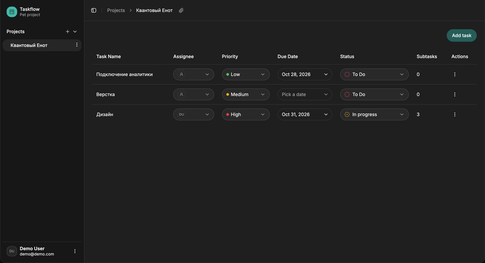
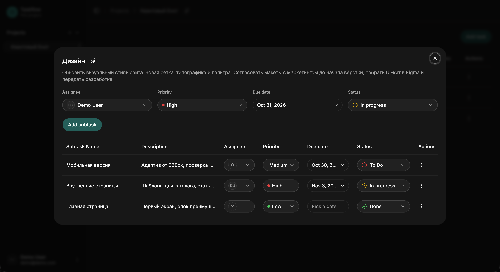

# CRM — таск-менеджер для небольших команд

Приложение для ведения проектов и задач: проекты с участниками, задачи со статусами,
приоритетами и сроками, вложенные подзадачи. Всё редактируется прямо в таблице,
без перехода на отдельные страницы.

Пет-проект, написан с нуля, чтобы разобраться с React, TypeScript и работой с реальным бэкендом.

**Демо: [crm-fawn-ten-55.vercel.app](https://crm-fawn-ten-55.vercel.app)**

Войти можно кнопкой **Try demo** на странице входа или вручную:

```
demo@demo.com
demo123456
```

## Скриншоты

| Список задач | Задача с подзадачами |
|---|---|
|  |  |

## Что умеет

- **Проекты** — создание, переименование, удаление, добавление и исключение участников
- **Задачи** — название, описание, исполнитель, приоритет, статус, срок. Всё меняется
  прямо в строке таблицы, без модальных окон
- **Подзадачи** — у каждой задачи свой список, в таблице задач показывается их количество
- **Ссылка на задачу** — задача открывается в диалоге, у которого есть собственный адрес.
  Ссылку можно скопировать кнопкой и отправить коллеге, она откроет ту же задачу
- **Сортировка** задач по названию, приоритету и статусу
- **Авторизация** — регистрация, вход, разграничение доступа: пользователь видит только
  те проекты, в которых состоит
- **Тёмная и светлая темы**

## Стек

| Слой | Инструменты |
|---|---|
| UI | React 19, TypeScript, Vite |
| Стили | Tailwind CSS v4, shadcn/ui на `@base-ui/react` |
| Формы | react-hook-form |
| Маршрутизация | react-router v8 |
| Даты | date-fns, react-day-picker |
| Бэкенд | Supabase — PostgreSQL, Auth, Row Level Security |
| Хостинг | Vercel |

## Как устроен код

```
src/
├── App.tsx         маршруты и провайдеры
├── pages/          страницы: вход, рабочая область, 404
├── widgets/        крупные самостоятельные блоки (сайдбар)
├── features/       бизнес-возможности: auth, projects, tasks, subtasks, users
│   └── tasks/
│       ├── api.ts          запросы к Supabase, только данные
│       ├── types.ts
│       ├── hooks/
│       └── components/
├── shared/         переиспользуемое между фичами: хуки, утилиты, типы
└── components/ui/  компоненты оформления из shadcn/ui
```

Разделение по слоям простое и соблюдается последовательно:

- `api.ts` знает только про запросы и возвращает `{ data, error }` — никакого состояния
  и никаких уведомлений
- хук держит состояние, обрабатывает ошибки и показывает тосты
- компонент занимается разметкой и не ходит в сеть

Общая для всех сущностей логика CRUD вынесена в один хук `useCrud` — списки задач,
подзадач и проектов используют его.

Целостность данных обеспечивает сама база: внешние ключи, каскадные удаления,
ограничения и политики Row Level Security. Клиент не решает, кому что можно —
на неразрешённый запрос Postgres просто не вернёт строки.

## Запуск локально

Нужен Node.js 20+ и проект в [Supabase](https://supabase.com).

```bash
git clone https://github.com/SvrTheCreator/crm.git
cd crm
npm install
```

Создай файл `.env` в корне:

```
VITE_SUPABASE_URL=https://ваш-проект.supabase.co
VITE_SUPABASE_PUBLISHABLE_KEY=ваш-publishable-key
```

Оба значения лежат в панели Supabase: Project Settings → API.

```bash
npm run dev        # запуск на http://127.0.0.1:5173
npm run build      # сборка в dist
npm run typecheck  # проверка типов
npm run lint       # проверка линтером
```

## Что дальше

Честный список того, что в проекте пока не сделано:

- пропсы местами прокидываются слишком глубоко — напрашивается вынос общего состояния
- нет тестов
- сборка одним файлом на 880 КБ, стоит разбить на чанки через динамические импорты
- задачи и подзадачи грузятся целиком, без пагинации
